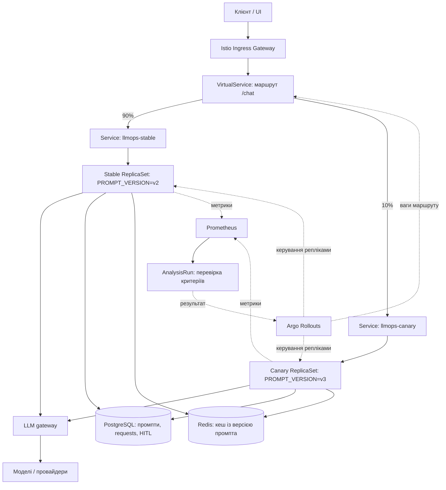

# Starter repository

Те, що студент клонує на першому уроці й дороблює до capstone.

**➡ Повний гайд для студента (вимоги, запуск, кожна папка, troubleshooting): [GETTING_STARTED.md](GETTING_STARTED.md).**
**➡ Домашні завдання — окремий файл на кожен тиждень: [homework/](homework/README.md).**

## Що дається готовим, що добудовує студент

| Компонент | Дається готовим | Студент добудовує |
|---|---|---|
| UI (Angular) | готові в'юхи: Chat + Console/Observability | не змінює |
| App service (.NET) | skeleton | control plane: routing, fallback, cost, policies |
| Observability API (.NET) | skeleton | агрегати з Postgres (traces, p95, cost, error-taxonomy) у Console-в'юху |
| Gateway (LiteLLM) | базовий конфіг | моделі/провайдери, порядок fallback |
| Mock provider | готовий | використовує для тестів і failure-сценаріїв |
| Postgres | базова схема | розширює під logs / cost / prompt records |
| Eval runner (Python) | skeleton | dataset, graders, пороги |
| CI (GitHub Actions) | шаблон `.github/workflows/eval-gate.yml` | eval gate |
| Redis | опційний сервіс у профілі advanced | ключ кешу, читання/запис, hits / misses |

## Запуск (мінімальний стек)

```sh
docker compose up --build
```

Піднімаються: UI (`:4200`), сервіс (`:8080`), LiteLLM (`:4000`), Postgres, mock provider.
Для mock реальні ключі не потрібні. Redis опційний: `make up-redis` запускає стек
із кешем, `make up` — основний стек без Redis. Для додавання Redis до запущеного
стеку — `make redis`; напряму через Compose — `docker compose --profile advanced up`.
Для оцінки якості (model-based evals): `cp gateway/.env.example gateway/.env` і заповнити ключі.

## Інцидент-демо (HW6)

[INCIDENT_RUNBOOK.md](INCIDENT_RUNBOOK.md) — команди для відтворення
сценарію «інцидент → fallback → відновлення», перевірки метрик та збору логів
в окремому демо-проєкті зі зсунутими портами.

## 30-day rollout

1. **Дні 1–7:** оберемо з командою один пілотний сценарій підтримки, призначимо відповідального та зберемо знеособлений golden dataset із типовими запитами, помилками й prompt injection для вимірювання початкової якості.
2. **Дні 8–14:** перенесемо промпти у версійний реєстр, доповнимо перевірки правил оцінкою змісту відповідей через LLM-as-judge, звіримо рішення judge з оцінками команди й врахуємо токени та вартість його викликів, після чого додамо evals до CI як обов'язковий чек перед merge й перевіримо блокування релізу навмисною регресією з подальшим rollback.
3. **Дні 15–21:** запустимо пілот у dry-run без незворотних дій, додамо маскування PII, HITL для таких дій, ліміти витрат і моніторинг p95, помилок, вартості та тижневого SLO 99%, щодня переглядаючи результати з командою.
4. **Дні 22–30:** проведемо інцидент-тренування за runbook із fallback та відновленням, перевіримо рішення HITL й rollback та дозволимо обмежений робочий запуск лише після проходження eval-гейта, виконання SLO і погодження відповідального.

## Canary-план для Kubernetes (HW6, опційно)

Це план майбутньої реалізації, а не готове розгортання: маніфести Kubernetes
та зміни service для canary ще не додані; поточний експорт метрик описано нижче
і він поки не розділяє показники за ревізіями промпта.
Мета — порівняти стабільний промпт v2 з новим кандидатом v3 на частині
реальних запитів, перш ніж переключити весь трафік; кандидат v3 має бути
робочою версією, а не навмисно зламаним промптом із демонстрації CI.

### Архітектура

Argo Rollouts керує стабільним і canary ReplicaSet одного `Rollout`, а Istio
розподіляє HTTP-запити між двома Kubernetes Service через `VirtualService`.
Ваги трафіку задаються окремо від кількості pod: 10% трафіку не вимагають
саме десяти реплік.



Інтеграція: [Argo Rollouts + Istio](https://argo-rollouts.readthedocs.io/en/stable/features/traffic-management/istio/).

### 1. Підготовка service до кількох реплік

- Додати вибір промпта за закріпленою `PROMPT_VERSION`: stable читає v2,
  canary — v3 з реєстру, незалежно від глобального `active`; відсутня версія
  має блокувати готовність pod, а не непомітно підмінятися іншою.
- Залишити однакові образ service, моделі та їхні параметри для обох груп,
  щоб у цьому експерименті змінювався тільки промпт; нова версія конфігурації
  у pod template запускає новий Rollout, вміст версій промпта не редагується.
- Зберегти фактичний `prompt_version` у `requests` і в ключі кешу, щоб відповіді
  v2 та v3 не змішувалися; додати ідентифікатор ревізії для зв'язку з релізом.
- Перенести заявки HITL та їхні рішення з пам'яті в PostgreSQL з атомарними
  переходами станів: approve/reject можуть потрапити на іншу репліку,
  а pod canary може бути видалений під час rollback.
- Додати агреговані метрики з усіх реплік із розподілом за версією промпта
  та ревізією; поточні загальні денні метрики й локальні лічильники процесу
  недостатні для порівняння stable/canary.

### 2. Передрелізний гейт

CI перевіряє обидві версії на одному golden dataset; для поточних 10 кейсів
потрібно щонайменше 9 успіхів, а критичні перевірки guardrails і HITL мають
проходити всі. LLM-as-judge доповнює правила, його рішення звіряються з
оцінками команди; токени й вартість judge обліковуються окремо.
До перевірки якості canary не отримує користувацького трафіку.

### 3. Поступове розширення

1. Розгорнути canary з 0% користувацького трафіку та виконати readiness/smoke-перевірки.
2. Переключити ваги Istio на stable/canary **90/10**.
3. Спостерігати щонайменше 30 хвилин і зібрати мінімум 1000 запитів у кожній
   групі за спільне вікно; якщо даних недостатньо, залишити rollout на паузі.
4. Після успішного аналізу й підтвердження відповідального перейти на **50/50**
   та повторити вимоги до вікна спостереження й кількості запитів.
5. Після повторного успіху виконати promote до **100% v3**, спостерігаючи
   за метриками та зберігаючи можливість повернення до v2.

Розподіляється основний `/chat`-трафік; службові запити, probes та evals
позначаються окремо й не повинні спотворювати вибірку користувацького трафіку.
Це частка HTTP-запитів: закріплення користувача за версією в цьому плані немає.

### 4. Критерії рішення

Наведені нижче значення — початкові критерії пілоту; команда погоджує їх
до запуску, не змінюючи постфактум під результат експерименту.

| Показник | Умова promote |
| --- | --- |
| Технічні помилки | Canary ≤ 1% і не більш ніж на 0,5 відсоткового пункту гірше stable |
| p95 затримки | Canary ≤ 120% p95 stable за те саме вікно |
| Середня вартість запиту | Canary ≤ 120% stable за однаковими правилами обліку |
| Якість | Повторний eval із judge проходить погоджений поріг; критичні кейси без регресій |
| Безпека й HITL | Немає підтверджених витоків PII або виконання дії без потрібного підтвердження |
| Дані для оцінки | Виконані мінімальні тривалість і обсяг вибірки, метрики доступні |

Помилки оцінюються за результатами service, зокрема за збереженим статусом
збою: HTTP 200 із текстом деградації не є успіхом. Окремо порівнюються 429,
таймаути, відмови guardrails і частота fallback; fallback, який приховав збій
основної моделі, не повинен маскувати деградацію canary.
Вартість та якість порівнюються з урахуванням складу запитів і cache-hit,
а не лише за загальними сумами двох груп різного розміру.

Порушення технічних порогів у валідному вікні або підтверджена критична
регресія запускають abort: 0% canary, 100% stable v2; відсутні метрики чи
недостатня вибірка зупиняють просування, але не вважаються успіхом.
Інтеграцію перевірок із контролером описує
[Argo Rollouts Analysis](https://argo-rollouts.readthedocs.io/en/stable/features/analysis/).

### 5. Promote / rollback та слід релізу

Promote завершує Rollout із v3 як новою стабільною ревізією; після фінального
підтвердження версія релізу фіксується в Git. Якщо зберігаються клієнти реєстру,
які читають глобальний `active`, його оновлюють окремою аудитованою операцією
лише після погодженого promote.

Abort повертає трафік на попередню стабільну ревізію, але не виправляє бажану
конфігурацію в Git: окремим revert повертаємо pod template до v2, щоб наступна
синхронізація не повторила невдалий реліз. Рішення HITL та історія запитів
зберігаються в БД незалежно від видалення canary-pod.
Для кожного рішення записуємо ревізію, версію промпта, ваги трафіку, вікно
аналізу, метрики, результат eval/judge, автора та причину promote/rollback.

## Metrics, Prometheus і Grafana (HW6, опційно)

`GET /metrics` експортує метрики у форматі Prometheus через
[prometheus-net](https://github.com/prometheus-net/prometheus-net).
Prometheus і Grafana додаються лише профілем `advanced`; основний service
не залежить від них. Точки входу в коді — `service/Observability/MetricsEndpoints.cs`
та `service/Observability/ServiceMetrics.cs`.

### Запуск

```bash
make up
make monitoring
```

`make monitoring` використовує той самий `PROJECT_NAME`, що й інші команди
Makefile, збирає service з `/metrics` та запускає Prometheus і Grafana з їхніми
залежностями; Redis окремо додається командою `make redis`.
`make up-redis` як і раніше запускає основний стек із Redis, без моніторингу.
Для всього профілю разом:

```bash
docker compose -p llmops-bootcamp --profile advanced up -d --build
```

- Метрики service: http://localhost:8080/metrics
- Prometheus: http://localhost:9090 — сторінка Targets має показати `llmops-service` як UP.
- Grafana: http://localhost:3000 — папка **LLMOps**, dashboard **LLMOps Overview**.
- Початковий логін Grafana: `admin`, пароль: `llmops-local`.

Prometheus і Grafana опубліковані тільки на loopback хоста.
Ім'я та початковий пароль задаються через `GRAFANA_ADMIN_USER` і
`GRAFANA_ADMIN_PASSWORD` до першого запуску Grafana; ці параметри не змінюють
пароль користувача, який уже зберігся в її томі.

Для вже запущеного інцидент-демо на зсунутих портах:

```bash
docker compose -p llmops-hw6-demo -f docker-compose.yml -f demo-ports.yml \
  --profile advanced up -d --build prometheus grafana
```

Тоді service доступний на http://localhost:8180/metrics,
Prometheus — http://localhost:9091, Grafana — http://localhost:3001.
Не змішуйте імена Compose-проєктів під час запуску та читання метрик.

### Що збирається

| Метрика | Тип і джерело |
| --- | --- |
| `llmops_requests_today` | Gauge: кількість рядків у БД за сьогодні |
| `llmops_latency_p95_today_seconds` | Gauge: p95 за сьогодні з БД у секундах |
| `llmops_error_ratio_today` | Gauge: частка збережених не-200 статусів, від 0 до 1 |
| `llmops_cost_today_usd` | Gauge: сума відомої вартості запитів за сьогодні |
| `llmops_database_metrics_available` | Gauge: 1 при успішному SQL-знімку, інакше 0 |
| `llmops_cache_lookups_total{result}` | Counter: hit/miss із наявного кешу |
| `llmops_fallback_events_total` | Counter: переходи до fallback |
| `llmops_error_events_total{reason}` | Counter: 429, tool timeout, guardrail refusal та inspection timeout |
| `llmops_provider_status{model,status}` | Gauge: 1 для поточного стану маршруту, 0 для решти |

Prometheus опитує `service:8080/metrics` кожні 15 секунд; один SQL-запит
читає денні агрегати, його очікування обмежене 5 секундами.
При недоступній БД endpoint усе ще експортує локальні лічильники, а денні
метрики стають `NaN` і `llmops_database_metrics_available=0`, а не нулями.
`up=1` означає успіх scrape, а не доступність усіх залежностей.
Сам `/metrics` не пише успішні polling-запити в info-лог і не додає рядків у `requests`.

Денні gauges скидаються на межі доби PostgreSQL; не застосовуйте до них `rate()`.
Це ті самі денні метрики, що в консолі, а не ковзне вікно останніх 5 хвилин.
Відсутність рядків дає нульовий p95, який означає відсутність вимірювань.
Вартість не включає невідомі ціни/usage і виклики judge з окремого eval-runner.
Локальні counters починаються з нуля після рестарту service; для швидкості
подій dashboard використовує `rate()`, що обробляє спостережувані скидання.
`tool_timeout` залишається нульовим, поки обробник справді не поверне таймаут.
Статус провайдера — останній стан breaker, а не активна мережева перевірка.
Повідомлення користувачів, email і request ID не додаються як labels.

### Dashboard і перевірка

Конфігурація datasource та dashboard підхоплюється автоматично через
[Grafana provisioning](https://grafana.com/docs/grafana/latest/administration/provisioning/):
`monitoring/grafana/provisioning/` та `monitoring/grafana/dashboards/llmops.json`.
`monitoring/prometheus/prometheus.yml` задає target і період опитування.
На dashboard є стан scrape/БД, денні запити, p95, error rate і вартість,
cache-hit, fallback, швидкість подій за причинами та статуси моделей.
Історія Prometheus зберігається 15 днів; дані обох систем — у named volumes,
які звичайний `make down` не видаляє.

Після власного запуску:

```bash
curl -fsS http://localhost:8080/metrics
curl -fsS http://localhost:9090/-/ready
curl -fsS http://localhost:3000/api/health
```

Прогрійте gateway, повторіть звичайний запит для cache-hit, відтворіть
`__fail_503` і guardrail-відмову, дочекайтеся щонайменше двох scrape та
перевірте зміни на dashboard. Для графіків `rate()` потрібні щонайменше дві
точки; на зовсім свіжому старті вони можуть ще не мати даних.
